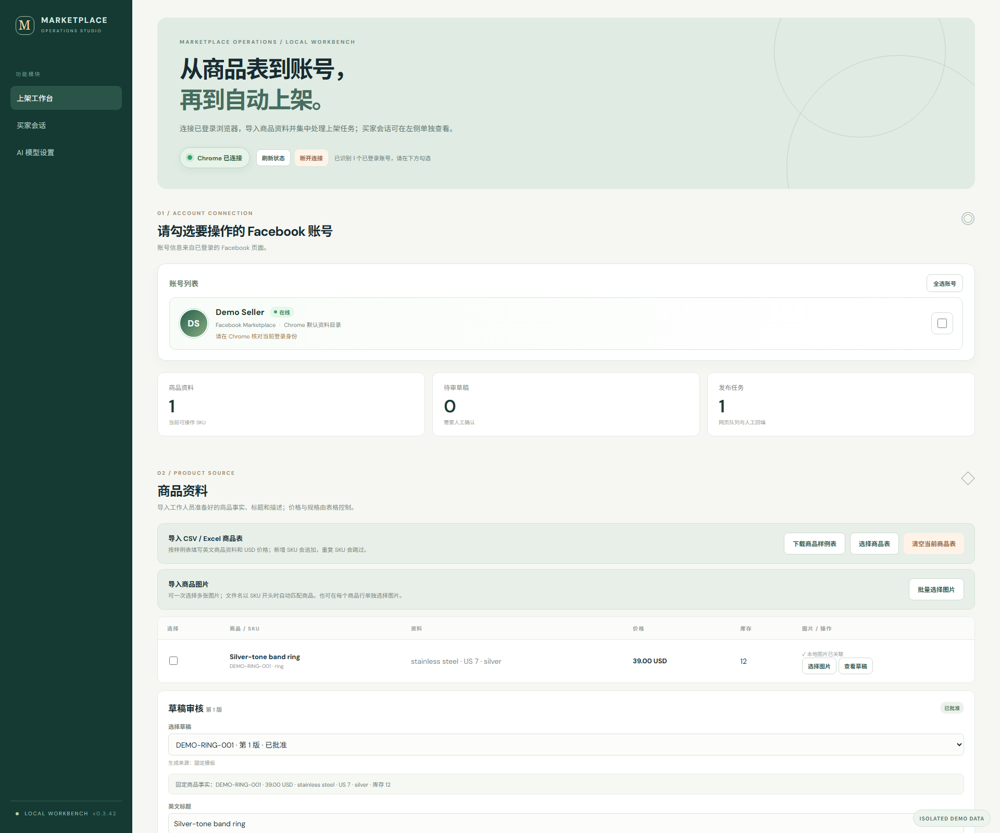
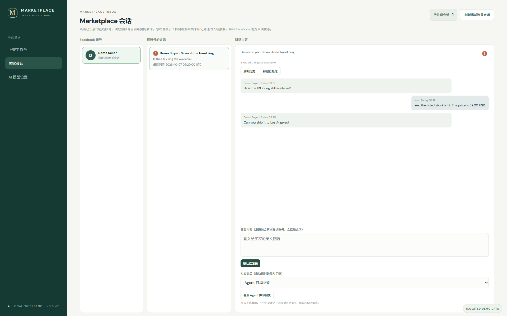
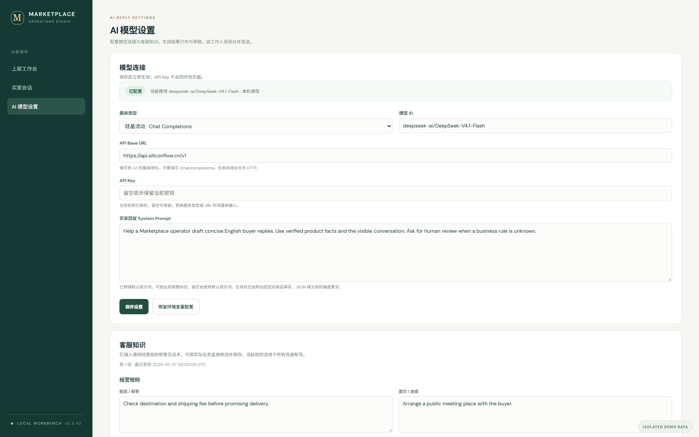
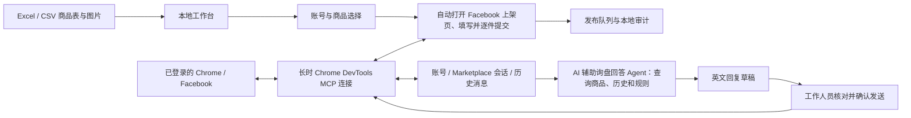

# Marketplace 自动化上架与 AI 辅助询盘工作台

一个在 **Windows 本机运行**的 Facebook Marketplace 自动化运营原型。工作人员准备好 Excel / CSV 商品表和图片，在工作台选择已登录的 Chrome 账号与商品后，程序会**自动导航到 Facebook Marketplace 新建商品页面，上传图片、填写标题、价格、分类、成色、地点和描述，并逐件提交上架**。上架结果和平台报错回到工作台的发布队列，无需工作人员反复打开页面、复制字段和点击发布。

买家会话在独立页面按账号集中查看。**AI 辅助询盘回答 Agent**会根据买家的最新问题，按需查询本地商品事实、会话历史和可配置的经营规则，生成有依据的英文回复草稿；工作人员核对后再发送。整个流程覆盖“商品资料 → 浏览器自动上架 → 会话跟进 → AI 辅助回复”。

> 项目为个人原型，与 Meta / Facebook 无关联。当前已实现并验证 **Chrome 默认资料目录中的单个账号**；多浏览器资料目录和多账号并行是后续扩展，不应将现有账号选择界面理解为已完成批量多账号接入。

## 核心能力

- **自动打开 Facebook 上架页：**复用工作人员已登录的 Chrome 标签页，自动进入 Marketplace 商品创建流程，无需提供 Facebook 密码或手动复制商品信息。
- **自动填写与逐件发布：**从商品表读取英文标题、描述、USD 价格、分类等字段，关联本地图片，逐件操作网页并记录“已提交、失败、待核实”等结果。
- **按账号集中处理询盘：**读取当前账号可见的 Marketplace 会话与历史，标记需要跟进的入站摘要，支持人工编辑与确认发送。
- **AI 辅助询盘回答 Agent：**先判断问题需要哪些资料，再查询商品、历史对话和经营知识；针对价格、库存、尺寸等已知事实直接拟答，并将不确定的经营承诺交给工作人员核对。

## 界面预览

以下是使用**隔离示例商品、示例账号和示例会话**渲染的真实工作台界面；截图不含真实买家消息或 API Key。

**上架工作台**：账号连接、商品导入与发布队列。



**买家会话**：按账号查看会话和历史消息。



**AI 模型设置**：模型连接、经营规则与常见话术。



## 解决的问题

- **重复填表：**将已有商品表和本地图片导入工作台，由程序自动打开 Facebook Marketplace 上架页、逐件填写和提交，记录每个 SKU 的执行结果和失败原因。
- **漏看询盘：**按当前在线账号读取 Marketplace 会话、查看可见历史，将新入站摘要标记为待处理。
- **回复缺少依据：**客服 Agent 根据买家最新问题查询商品事实、会话历史和经营规则，生成可编辑草稿；工作人员确认后才发送。
- **过程难追踪：**商品、草稿、发布任务、会话和操作记录保存在本机 SQLite；重启后能查看历史，进行中的发布任务不会自动重发。

## 工作流程



### 浏览器账号是怎样接入的？

工作台是 `FastAPI` 服务，只监听本机 `127.0.0.1`。点击“连接当前 Chrome”后，后端启动一个**长时存活**的 `chrome-devtools-mcp@1.12.0 --autoConnect` 子进程，并通过 MCP stdio 会话调用浏览器工具。Chrome 的远程调试授权由用户在浏览器中允许；服务进程保持连接期间复用该会话。连接状态、账号名称和头像来自已登录 Facebook 页面的可见内容，不采集或保存 Facebook 密码。开始上架时，程序复用这个连接，**自动在已登录的浏览器标签页中打开 Facebook Marketplace 创建商品页面**；它不会替工作人员启动一个新浏览器资料目录或自动登录账号。Chrome 或工作台服务重启后可能需要重新授权。

当前适配器使用 Chrome **默认资料目录**，以 `chrome-default` 作为本地账号键。界面显示的勾选、全选和“按账号查看会话”为未来多资料目录保留交互，但现阶段同一时刻只识别一个在线账号。拇指浏览器、HubStudio 等浏览器的独立资料目录尚未接入。

### 自动化上架是怎样执行的？

1. 导入商品表。以 SKU 为唯一码，追加新 SKU、跳过重复项；图片可按 SKU 文件名前缀批量匹配。工作人员审核标题、描述、价格、成色、分类和图片。
2. 勾选在线账号和商品，点击“开始自动化上架”。后端创建逐件任务，**顺序**处理，避免并发操作同一个网页。
3. 浏览器网关自动打开 Facebook Marketplace 的创建商品页，利用页面快照定位控件，上传本地图片、填写标题与 USD 价格、选择分类和成色、设置洛杉矶地点、填写描述，检查表单提示与按钮状态，再依次点击 `Next` 和 `Publish`。
4. 提交后读取网页结果和卖家销售列表。识别到对应商品或商品链接时，任务记为“已发布”；Facebook 显示“正在审核”也按**已提交发布**记录，同时保留审核备注。这不表示审核通过或商品已公开展示。
5. 页面若返回 `Limit reached`、描述无效、地点无法确认等错误，任务显示具体原因并暂停后续队列。结果不明确时标记“待核实”；服务重启不会自动重发，避免重复商品。

这条链路操作的是**工作人员已登录的 Facebook 网页**，并未使用个人 Marketplace 批量发布 API。Meta 的 Catalog / Batch API 面向商业商品目录，不能直接等同于个人账号 Marketplace 商品帖的创建接口。Facebook 网页结构、账号资格和平台限制会影响自动化，异常需要人工处理。

### 买家会话与 AI 辅助询盘回答 Agent

会话页采用“**在线账号 → 该账号的会话 → 对话内容**”布局。点击账号才会从当前 Facebook 页面读取可见的 Marketplace 会话；没有在线账号或没有会话时显示空状态，不拿历史数据库记录冒充实时消息。点击会话读取历史，工作人员可以手写回复并确认发送。感叹号表示**工作台检测到尚未处理的入站摘要**，不等同于 Facebook 官方未读数。页面内切换模块会保留本轮已读取的会话缓存；断线、换账号或整页刷新后需要重新读取。

点击“客服 Agent 拟写回复”会执行一个**有边界的两步 Agent 流程**：

1. 模型根据最新买家消息、会话标题和最近消息，规划需要读取的资料。
2. 后端将会话与本地商品表匹配；无法唯一匹配时要求工作人员手选商品。按规划读取商品事实、完整会话历史及相关经营规则 / 参考话术，再请求模型生成英文回复。
3. 后端检查结构化价格与币种、库存表述等冲突，并返回查询依据与待确认项。草稿填入回复框，**不会自动发送**；工作人员核对账号、商品、会话和文字后确认发送。

例如，买家问“还有货吗、多少钱”时，Agent 可读取商品表的库存和价格并直接拟答；询问邮寄时，会结合已配置的配送规则和会话上下文，询问必要的目的地信息，避免凭空给出运费或时效。查询路径和所用规则会回显在草稿旁，方便工作人员审核。

商品信息来自导入表，规则和话术可在“AI 模型设置”编辑。默认包含配送、面交、付款、退换与议价规则，以及库存、价格、尺寸等直接答复句式。缺少可靠事实或业务规则时提示人工确认；已知价格、库存和规格应直接回答。当前经营知识对所有连接账号共用，尚未实现账号级规则。

## 快速运行

**环境：**Windows 10/11、Python 3.10+、Node.js / `npx`、Google Chrome。网页自动化需要 Chrome 支持远程调试并由用户允许连接；AI 草稿还需要自备兼容模型服务的 API Key。

```powershell
git clone https://github.com/BaryyAoAo/marketplace-operations-workbench.git
cd marketplace-operations-workbench
py -m venv .venv
.\.venv\Scripts\Activate.ps1
python -m pip install -r requirements.txt
python -m uvicorn app:app --host 127.0.0.1 --port 8765
```

打开 <http://127.0.0.1:8765>。先在**同一 Chrome 默认资料目录**打开并登录 Facebook，在工作台连接 Chrome，按浏览器提示授权，再刷新账号状态。首次使用可下载页面中的商品样例表，在“商品导入”工作表填写数据并导入；“填写示例”工作表仅供参考。当前自动上架流程限定英语商品资料、USD 价格和洛杉矶地点。导入表格本身不会触发发布，必须由工作人员选商品并启动任务。

模型设置页默认填写硅基流动 Base URL 与 `deepseek-ai/DeepSeek-V4.1-Flash` 模型 ID；按实际可用模型调整并在本机输入 API Key。也可选择其他兼容 Chat Completions JSON 的服务，或 OpenAI Responses。Key 保存后输入框恢复为空，表示**不会回传密钥**；状态“已配置”表示本机仍有可用密钥。Windows 下通过当前用户的 DPAPI 加密存放在 `data/ai_settings.json`。生成 AI 草稿时，会话消息及必要商品资料会发送给所配置的模型服务，界面会在调用前要求确认。

运行测试：

```powershell
python -m pytest -q
```

## 商品表与本地存储

商品表支持 `.csv` 和 `.xlsx`。必填列：`sku,name,category,condition,price,currency,stock,material,size,color,source_note`；可选列：`image_url,listing_title,listing_description`。图片通过页面另行导入，支持 JPEG、PNG 和 WebP。网页发布需要英文标题、描述和本地图片。重复 SKU 会按行报告且不覆盖旧商品；“清空当前商品表”归档当前商品，再导入可复用 SKU，历史发布任务仍可追溯。该操作不会删除 Facebook 上的商品。

SQLite 文件位于 `data/workbench.db`，图片在 `data/product_images/`，客服知识在 `data/ai_reply_knowledge.json`。这些文件可能含账号资料、买家消息或密钥，**已由 `.gitignore` 排除，不应手动提交**。浏览器的登录状态仍留在 Chrome 资料目录中，工作台不复制 Cookie 或密码。项目中的 `outputs/product-template/商品导入模板.xlsx` 是可公开的空白导入模板。

## 技术结构与边界

| 模块 | 实现 | 当前边界 |
| --- | --- | --- |
| 本地 Web 工作台 | FastAPI + 原生 HTML / CSS / JavaScript | 单机运行，未设计公网部署与多人权限 |
| 浏览器接入 | Python MCP Client + Chrome DevTools MCP 长时会话 | Chrome 默认资料目录中的单账号 |
| 商品与任务 | SQLite、CSV / XLSX 解析、图片关联、顺序任务队列 | 英语 / USD / 洛杉矶，平台网页可能变化 |
| 会话 | 页面可见列表与历史读取、手动确认发送、待处理标记 | 当前验证以买家侧会话为主；卖家侧新询盘覆盖仍需更多实测 |
| 客服 Agent | 受控规划、只读查询、模型生成、结构化校验、人工发送 | 商品匹配不唯一时手选；不会自主承诺未知业务条件 |
| 可选扩展 | `mcp_server.py`、`skills/marketplace-operator/` | 非上架与客服主流程依赖；不提供绕过人工确认的发布/发送工具 |

**验证边界：**本机曾通过工作台将一件商品提交到 Facebook 销售列表，页面显示“正在审核”；曾读取两条买家侧 Marketplace 会话和一条会话的可见历史，并完成一次经用户指定的测试消息发送。用户随后完成了工作台整体和 AI 配置测试，反馈未发现问题。上述记录不代表多账号批量发布、卖家侧新询盘长期稳定性、Facebook 审核通过率或商品公开曝光已获验证。

项目不隶属于 Meta；请仅操作有权限使用的账号，并根据 Facebook 当前页面和规则处理账号限制。网页自动化无法保证跨版本稳定，发生平台拦截时应以页面提示为准。
